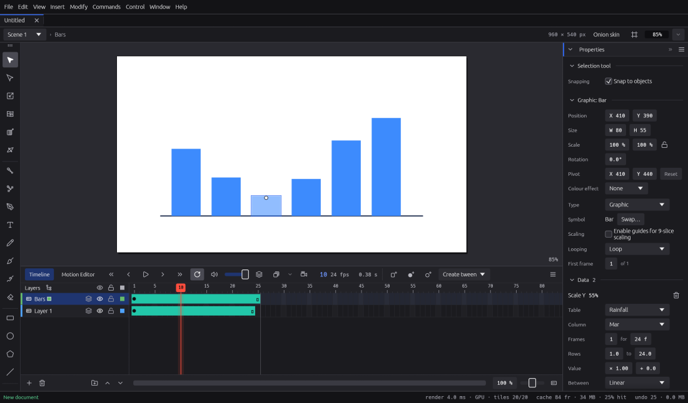
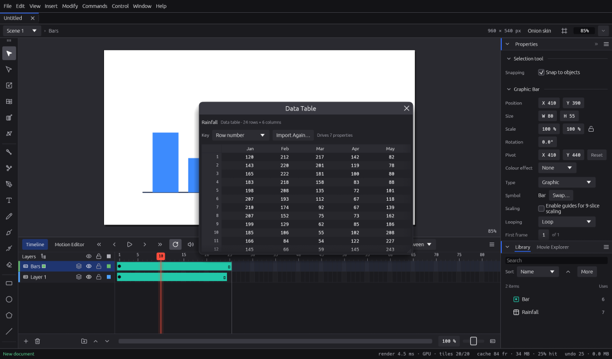

# Data-driven animation

Numbers can animate for you. Keep a table of them in your document, let a column drive a
property of an instance, and the animation follows the data: a bar chart that grows month by
month, a marker that moves with a measured level, an outline that changes with a record. When
the numbers are revised, import the file again and every frame follows, with no keyframes to
redo.

## Importing a table

**File › Import › Import Data Table…** reads a table of numbers into the Library from:

* **CSV** or **TSV** text (comma, semicolon or tab separated), as spreadsheets export it. The
  first line names the columns. In semicolon and tab files a decimal comma is read (`3,5`).
* **JSON**: a list of records (`[{"age": 100, "pinus": 12}, …]`), a list of rows with the names
  first (`[["age", "pinus"], [100, 12], …]`), or columns by name (`{"age": [100, …], "pinus":
  [12, …]}`).

A table keeps numbers. A cell that isn't a number (an empty cell, `n/a`) becomes a **gap**, and
a column with no numbers at all, such as sample names, is left out; the status bar tells you
which. A table holds up to 100,000 rows, 256 columns and a million cells, and a file up to
32 MB is read.

The table appears in the **Library** with a small grid icon, like a symbol or a sound. The
Library shows its first rows; **View Table** (or a double-click) opens every row and column.

### A row per frame, or a row per time

How rows are looked up is the table's **Key**:

* **Row number** (the default): rows are counted from the top. Bind a column over as many
  frames as the table has rows and each frame shows one row.
* **A column**, such as an age, a depth or a time in seconds: rows are looked up by that
  column's value, and the table sorts itself by it. Choose this when your rows aren't evenly
  spaced.

Set it in the Library, under the table's preview, or in the viewer.

### When the data changes

Select the table and choose **Import Again…**, then pick the file (the same one, revised, or
another). The table's values are replaced and everything bound to it follows at once. Bindings
find their columns by name, so the columns may come in another order. If a column a binding
reads is gone, that binding rests (its instance stays as you placed it) and the status bar names
the column.

## Binding a column to an instance

Data drives **symbol instances**. To bind one:

1. Select the instance on the stage (convert artwork with **Modify › Convert to Symbol** first).
2. Choose **Modify › Data › Bind to Data…**, or **Bind to Data** in the **Data** section of
   Properties, and pick the property there.
3. In Properties, under **Data**, choose the **Table** and the **Column**.

The stage shows the result as you change it. You can bind each of these once per instance:

| Property | The column's number is |
|---|---|
| **X**, **Y** | the position in pixels |
| **Scale X**, **Scale Y** | the size in percent (100 is the size you drew) |
| **Rotation** | degrees, clockwise |
| **Alpha** | opacity in percent |
| **Frame shown** | which frame of a graphic symbol shows, counted from 0 |

Under each binding:

* **Frames**: the first frame of the span the table plays over, and how many frames it lasts.
  Before the span the instance shows the first frame's value and after it the last's, so a
  chart holds its last value when the data ends.
* **Rows** (or **Keys**, for a table with a key column): what the first and the last frame of
  the span show. They start as the whole table; **All** goes back to that. Set the second
  before the first to play the table backwards, for ages that run from old to young.
* **Value**: the column's number **×** a scale **+** an offset. Use them to turn your units into
  pixels or percent: a rainfall of 0 to 300 mm with × 0.5 is a bar 0 to 150 % tall.
* **Between**: **Linear** moves straight from one row's value to the next; **Step** holds each
  row's value until the next row.

The number beside the binding's name is what it gives at the playhead. A binding replaces the
property; the rest still animates as usual, so an instance whose X is tweened and whose Y is
bound moves along both.

> **A bar that grows from its foot.** Scale and rotation turn about the instance's
> transformation point. With the Free Transform tool, drag the small circle to the bar's foot
> (or set **Pivot** in Properties), and a bound **Scale Y** grows the bar upwards.

### A shape that changes with the data

Draw the states in a **graphic** symbol, one per frame, or a shape tween from one outline to
another. Bind the instance's **Frame shown** to a column: the data picks which frame of the
symbol shows. 0 is the symbol's first frame; use **Value** to turn your numbers into frames. With
**Step** the outline holds through each regime; with **Linear** it changes smoothly.

## Baking to keyframes

**Bake to Keyframes** (in the Data section, or **Modify › Data › Bake Data to Keyframes**)
writes what the bindings show as ordinary keyframes and removes the bindings. Every frame looks
as it did. Bake when you want to adjust keys by hand, or before **Lottie** export, which writes
keys rather than pictures. The other exports (PNG, GIF, video, HTML canvas, sprite sheets) show
bindings as they are.

Baking can't cut a motion tween (remove the tween first) or work on an armature layer or a
locked layer; it tells you, and changes nothing.

**Modify › Data › Remove Data Bindings** takes the bindings off the selected instances without
writing keys: each property is the instance's own again.

## Managing tables

A table is a Library item: rename it, put it in a folder, or delete it there. Deleting a table
also removes the bindings that read it; **Edit › Undo** brings both back. The **Uses** column
counts the bindings that read each table, and **Select Unused Items** finds tables nothing
reads.

The numbers are saved inside your `.anicraft` file, so the document carries its data with it.
The table remembers the name of the file it came from, never its folder.

## From scripts and AI assistants

Every step is a command, so a pipeline can build a chart without the window (see
[Working headless](working-headless.md)): `data.import_table` or `data.set_table` for the
numbers, `data.bind` for each instance, `data.bake` for plain keys, and `data.list`, `data.get`
and `data.bindings` to read them back. The [command reference](reference/commands.md) lists
their parameters. Plug-ins can use all of them except reading a file.

## Not yet

* Copying, pasting or duplicating a bound instance doesn't copy its bindings.
* Cells can't be edited in the viewer yet (`data.set_cell` changes one from a script).
* Only symbol instances are bound, and only the properties above; captions driven by text
  columns are planned.
* Baking inside a motion tween.

## Next steps

* [Tweens](tweens.md): animate the properties data doesn't drive.
* [Symbols and the Library](symbols-and-library.md): graphic symbols and the transformation point.
* [Exporting and Publish](exporting-and-publish.md): share the result.
