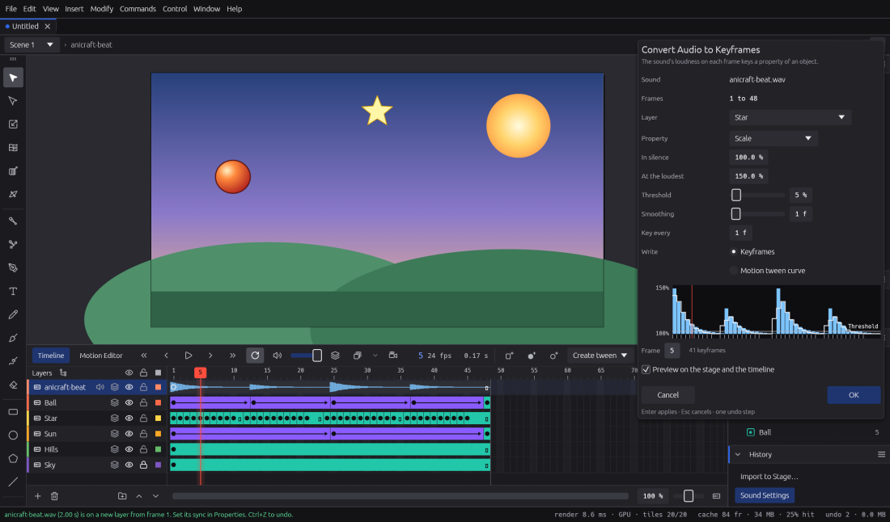
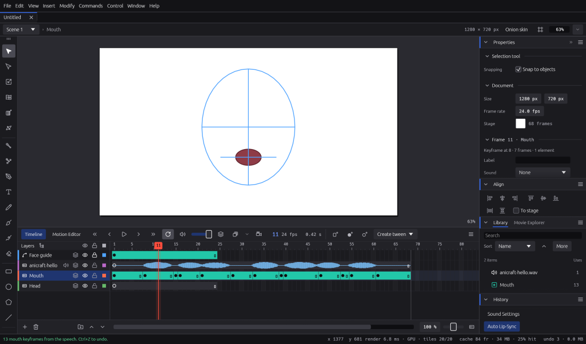

# Images and sound

This chapter covers bringing pictures, SVG drawings and sounds into AniCraft, and putting sound
to work on the timeline: sync, loops, fades, volume and sounds inside symbols and buttons.

On a Mac, read **⌘** wherever this chapter says **Ctrl**, and **⌥** for **Alt**.

## What AniCraft can bring in

| Kind | Files | Comes in as |
|---|---|---|
| Images | PNG, JPEG | A bitmap in the Library, placed on the stage as a bitmap |
| Drawings | SVG | Editable shapes, groups, gradients, masks and text |
| Sounds | WAV, Ogg Vorbis, MP3 | A sound in the Library, played from a keyframe |

Anything else is turned away with one line in the status bar that says what AniCraft takes.

## Importing images

### Onto the stage

1. Click the frame where the image should appear.
2. Choose **File › Import › Import to Stage…** (**Ctrl+R**, **⌘R** on macOS) and pick a PNG
   or JPEG.
3. The image arrives on a new layer named after the file, centred on the stage and selected.

It goes into the Library at the same time. From here it is ordinary artwork: move, scale,
rotate, fade, tween and mask it like anything else. It stays smooth at every size, on the stage
and in every export.

Images are stored inside your `.anicraft` document, so you can move the document to another
computer without the original files. JPEGs are converted to PNG without losing quality, which
can make the document larger than the JPEG was.

### Into the Library only

Choose **File › Import › Import to Library…** to add an image without placing it. Then, in the
Library:

* drag it onto the stage, where it lands under the pointer on the active layer at the playhead;
* or select it and press **Place on Stage** (or **Enter**, or right-click › Place on Stage) to
  put it at the centre of the view;
* or double-click it to add another copy centred on the stage.

Every copy shares the one image, so placing it many times costs nothing extra.

### Smoothing

Select a bitmap in the Library to see its properties. Turn off **Allow Smoothing** for pixel
art: the bitmap then keeps hard pixel edges on the stage, in renders, in SVG and in the HTML
page.

### Swap Bitmap

To show a different image in the same place, select the placed bitmap and use **Swap…** on the
**Bitmap** row of **Properties**. Pick another bitmap from the list. A placed bitmap keeps its
position and transform and takes the new image's size; a shape painted with a bitmap fill keeps
its outline and shows the new image inside it. With several bitmaps selected, they all change.

## Importing SVG drawings

SVG files from illustration tools come in as artwork you can keep editing, not as a flat picture.

1. Click the frame where the drawing should start.
2. Choose **File › Import › Import to Stage…** (**Ctrl+R**) and pick the `.svg` file.
3. The drawing arrives on a new layer named after the file, centred and selected, as one undo
   step.

### What comes across

* Paths and basic shapes, with their fills and strokes, including stroke caps, joins, miter
  limits and dashes.
* Groups, reused parts (`use` and symbols), transforms and the drawing's view box.
* Inline and attribute styles, and opacity.
* Linear and radial gradients, with their spread (reflect, repeat), linear-RGB blending, focal
  point and transform.
* **Clip paths and masks.** A drawing with clipping comes in as a layer folder named after the
  file. Each clipped group sits on a masked layer under a mask layer that holds the clip's shape,
  so you can move or reshape the mask afterwards. Clips that cut nothing, like the frame clip
  many design tools add, are dropped. Solid masks become ordinary (Shape) masks; faded, grey or
  gradient masks become **soft masks** (mask type Luminance, or Alpha when the SVG says so).
* **Text** comes in as text you can edit, one block per positioned line, with its font, size,
  weight, italic, colour, letter spacing and alignment. Text on a path comes in as text on a
  path. Characters the SVG places one by one (moved, shifted or turned) come in as small blocks
  of their own where they are. Fonts that aren't on your computer fall
  back to the default, and the status bar names them.

### What doesn't come across yet

AniCraft lists these in the status bar after the import, instead of guessing:

* images embedded in the SVG, filters, style sheets (inline styles are read) and pattern fills;
* gradient strokes (drawn in one colour).

### An SVG as a symbol

**File › Import › Import to Library…** with an SVG makes one **graphic symbol**, named after
the file, that holds the drawing's layers. Place it as often as you like; edit the symbol and
every copy changes. See [Symbols and the Library](symbols-and-library.md).

## Dropping files from your desktop

You can drag files straight from your file manager onto AniCraft's window. Each drop is one
undo step, however many files it brings, and a highlight shows where they will land.

| Drop it on | What happens |
|---|---|
| The **stage** | Drawings and images go onto the active layer at the playhead, centred where you let go. A sound goes onto the active layer's keyframe. |
| A layer's **frame** in the timeline | A sound goes onto that keyframe. An image or drawing goes onto that layer at that frame, in a new keyframe if there isn't one. |
| The **Library** | The files go into the Library folder under the pointer. An SVG becomes a graphic symbol. |

A drawing whose clipping needs several layers can't sit on one layer, so dropped on the stage
it arrives as a graphic symbol instead. Locked layers, folders and the camera layer say why
they won't take a drop.

On the desktop, AniCraft learns exactly where you dropped once you move the pointer again; if
you don't, the drop lands in the middle of the view. Dropping `.anicraft`, `.fla` or `.xfl`
files opens them instead (see [Opening Animate files](opening-animate-files.md)).

## Importing sounds

AniCraft reads WAV, Ogg Vorbis and MP3 files.

* **File › Import › Import to Stage…** (**Ctrl+R**) with a sound puts it on a new layer, named
  after the file, starting at the playhead. The layer's frames run as long as the sound, so you
  see its whole waveform.
* **File › Import › Import to Library…** only adds it to the Library.

Sounds are saved inside the document exactly as imported.

In the Library, select a sound to see its waveform with a play button. Drag it onto the stage to
put it on the active layer's keyframe, or use **Place on Timeline**. Deleting a sound that
keyframes use asks first, and you can undo it.

## Sounds on keyframes

As in Animate, a sound belongs to a keyframe. Select the keyframe and open the **Sound** rows
in **Properties**.

1. **Sound**: pick one from the Library, or **None** to take it off.
2. **Sync**: how it plays (see below).
3. **Repeat**: play it a set number of times in a row (**Repeat** with a count), or choose
   **Loop** to play it again and again.
4. **Effect**: a fade or pan (see below).

Below the rows you see the sound's length, sample rate, channels and format.

### Sync

| Sync | What it does |
|---|---|
| **Event** | Plays in full from this keyframe, independent of the timeline. Good for clicks and hits. |
| **Start** | Like Event, but doesn't start again if the sound is already playing. |
| **Stop** | Stops this sound. |
| **Stream** | Tied to the frames: plays over this span and follows the playhead. Use it for dialogue and lip sync. |

A looping Event sound plays to the end of the movie; a looping Stream sound to the end of its
span.

### Waveforms on the timeline

The timeline draws each sound's waveform over its frames, so you can line up keys with beats
and syllables. The waveform follows the sound's effect, so a fade-out shows as a shrinking
wave.

### Effects and the envelope

The **Effect** menu has Animate's presets: **None**, **Left channel**, **Right channel**,
**Fade left to right**, **Fade right to left**, **Fade in** and **Fade out**. Each is shaped
over the time the sound is actually heard.

For your own volume curve, press **Edit…** next to Effect (or choose **Custom**). The **Edit
Envelope** window shows each channel's waveform with its volume line:

1. Click a channel to add a volume point (up to 16).
2. Drag a point to move it, or right-click it to delete it.
3. Or select a point and type its time and its left and right levels.
4. Press **Play** to hear the sound with its envelope.

Times can read in frames or seconds, and you can zoom in, out or fit the whole sound. Editing a
preset turns it into **Custom**.

### Layer volume and mute

A layer that holds sounds has a **Volume** (0–100 %) and **Mute** in **Properties**, and a
speaker toggle in its timeline row. Volume applies to the layer's sounds and to sounds inside
the symbols on it. A muted layer is silent while you work and in every export, which is handy
while you time other tracks.

## Convert Audio to Keyframes

A sound can animate for you. **Convert Audio to Keyframes** measures how loud the sound is on
each frame and writes that onto a property of an object: a speaker that pulses with the beat, a
logo that brightens on every hit, a jaw that drops when a character talks.

1. Put the sound on a layer and the object on another layer. **Stream** sync is best: the
   sound then stays on its frames. With Event or Start sync the dialog still works, and a line
   under **Frames** reminds you that the keys can drift from what is heard after a jump on the
   timeline.
2. Choose **Modify › Timeline › Convert Audio to Keyframes…**, or select the sound's keyframe
   and press **To Keyframes…** in **Properties**.
3. Pick the **Layer** that gets the keys (and the **Object**, when the layer holds several).
4. Pick the **Property**, and its value **In silence** and **At the loudest**:

   | Property | The values are |
   |---|---|
   | **Scale**, **Scale X**, **Scale Y** | percent of the object's own size (100 % is as it is) |
   | **Alpha** | opacity in percent |
   | **X offset**, **Y offset** | pixels from where the object is (negative Y is up) |
   | **Rotation** | degrees from how the object is turned |
   | **First frame** | a frame of a graphic symbol: louder shows a later frame, held as a single frame |

5. Shape the movement:
   * **Threshold** ignores everything quieter than this share of the loudest frame. Raise it
     so background noise doesn't make the object tremble, or so only the loud beats count.
   * **Smoothing** averages each frame with the frames either side. 0 follows every flick;
     higher values are calmer. The beat stays on its frame.
   * **Channel** (stereo sounds) measures the left side, the right side or both.
   * **Key every** 2 frames animates on twos, and so on.
6. Choose what to **Write**: **Keyframes** on the layer, as if you had set each by hand, or a
   **Motion tween curve**, which keeps the span whole and shows in the Motion Editor (a motion
   tween is made for an object alone on its layer).
7. Press **OK**. It is one undo step.

Everything is previewed while you change it. The graph shows the sound's loudness frame by
frame, the threshold, the value the keys will follow (the white line) and a tick where each
key lands; the stage and the timeline show the keys themselves. Click or drag in the graph to
see another frame on the stage. Clear **Preview** to compare with the document as it was.

Scale and rotation turn about the object's transformation point (the middle of a shape that
has none). Keyframes that were already on the layer keep their place and take the value. After
the sound ends, the layer carries on as it was. A layer shorter than the sound grows to its
length.

## Auto lip-sync

**Auto Lip-Sync** listens to speech and picks a mouth for every frame, as Animate's Lip Syncing
does. It is a first pass: expect to fix some mouths by hand afterwards.

1. Draw the mouths as the frames of a **graphic symbol**, one frame per mouth, and put an
   instance on its own layer. **File › New from Template › Lip-sync mouth chart** gives you a
   Mouth symbol with ten labelled frames to redraw.
2. Put the dialogue on another layer, with **Stream** sync.
3. Select the mouth and press **Lip Sync…** in **Properties** (beside Looping), or choose
   **Modify › Timeline › Auto Lip-Sync…**.
4. Check the **Mouths**. AniCraft tells five mouth shapes apart and needs a frame of your
   symbol for each:

   | Mouth | Sounds | Frame label it looks for |
   |---|---|---|
   | **Rest** | silence | Rest |
   | **Open** | ah, as in *father* and *cat* | AI |
   | **Wide** | ee and e, and the hiss of s and t | E |
   | **Round** | oh, oo and w | O |
   | **Closed** | m, b, p and the short stops between syllables | MBP |

   Frames are found by their labels (other common names such as *open*, *wide*, *round* and
   *closed* work too). Choose another frame for any mouth from its menu.
5. **Silence below** sets how quiet counts as silence. **Hold each mouth** is the fewest frames
   a mouth stays, so it doesn't flicker; closed lips are kept however short.
6. Press **OK**. The Mouth layer gets a keyframe wherever the mouth changes, each showing one
   frame of the symbol (**Single frame**). It is one undo step.

The preview shows a row for each mouth with the frames it gets, under the sound's loudness.

How it listens: no speech recognition and nothing sent anywhere. Each frame's sound is sorted
by where its energy lies (low for *oo*, in the middle for *ah*, high for *ee* and *s*), which is
what tells vowels apart. It cannot tell *f* from *s* or *l* from *d*, so the chart's other mouths
(FV, L, WQ, U and the consonants) are yours to place. The same sound always gives the same
keys.

To fix a mouth afterwards, select its keyframe and change **First frame** in Properties, or
move the keyframe on the timeline.

## Sounds inside symbols and buttons

Sounds placed on a symbol's own timeline play too:

* in a **graphic**, they play on the symbol's frames as the parent timeline shows them; looping
  and the first frame setting apply, and a stream reached part-way through is heard from there;
* in a **movie clip**, they play on the clip's own loop from when it appears;
* volumes multiply down through nested symbols.

**Buttons** can have sounds on their state frames. A sound on the **Over** frame plays when the
pointer goes over the button, and one on **Down** when it is pressed. As in published Animate
movies, the **Up** frame's sound plays when the pointer leaves, and the **Hit** frame's when you
let go over it. Button sounds play in Test Movie and the HTML canvas page, and stay out of the
soundtrack: audio and video exports don't include them. See
[Interactivity](interactivity.md#buttons).

## Hearing it: playback and scrubbing

* Press **Enter** (**Control › Play**) to play the movie with its sound. The playhead follows the
  sound being heard, so picture and sound stay together: if your computer can't draw every
  frame in time, frames are skipped rather than the picture falling behind.
* **Stream** sounds pick up wherever the playhead jumps.
* **Event** sounds play to their end: when Loop Playback goes round to frame 1, or the playhead
  stops on the last frame, they carry on. Press **Enter** again to stop all sound.
* **Drag the playhead** to scrub: you hear a short slice of the stream sounds under it, which
  helps with lip sync. Turn it off with **Control › Audio Scrubbing**.
* **Test Movie** (**Ctrl+Enter**) plays the sounds too, including those in movie clips, graphics
  and buttons.

### Volume and mute while you work

The speaker and slider in the timeline's header set how loud you hear the movie; click the
speaker (or choose **Control › Mute Sounds**) to silence it. They are yours, not the document's:
they're kept in your preferences (**Preferences › Sound**) and never change an export. To make a
layer quieter in the movie itself, use its volume in Properties.

If there is no sound device, or it is unplugged while playing, playback carries on silently and
the status bar says so; plug one in and press **Enter** again. A new default device (headphones
plugged in) is followed on its own where the system allows.

The web version plays sound through the browser (Web Audio); the browser lets it start on your
first play.

## Getting sound out

* **File › Export › Export Audio…** writes the soundtrack as a WAV file.
* **Export Video…** includes the soundtrack.
* The HTML canvas page plays the sounds, with their envelopes and volumes.

Lottie animations carry no sound. See [Exporting and Publish](exporting-and-publish.md).

## Not yet

* Picking a colour from a bitmap's pixels with the Eyedropper.
* Panning beyond what the envelope does.
* Convert Audio to Keyframes on the camera or an armature layer, a filter's values, or with a
  classic tween between the keys; the sound's own effect (a fade) isn't counted in its
  loudness.
* Lip-sync that tells more mouths apart (F and V, L, the chart's other consonants), or reads a
  script; lip-syncing several sounds in one go.
